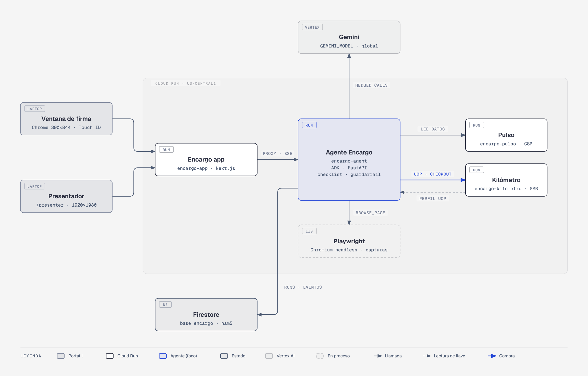
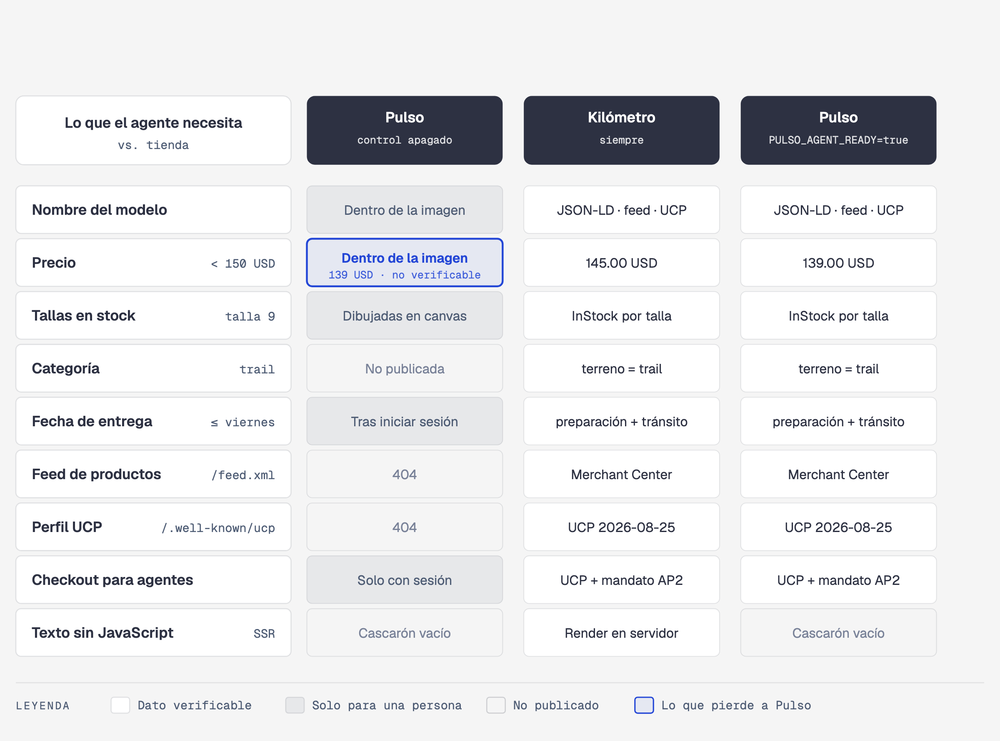
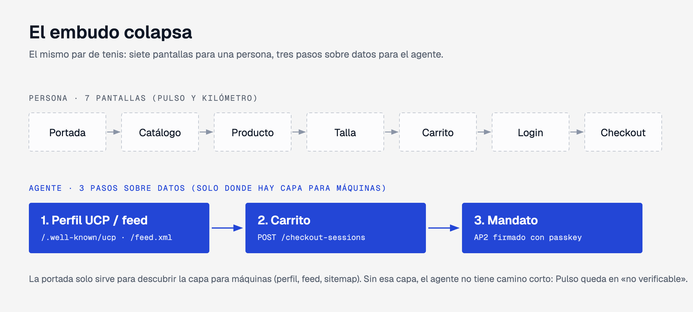
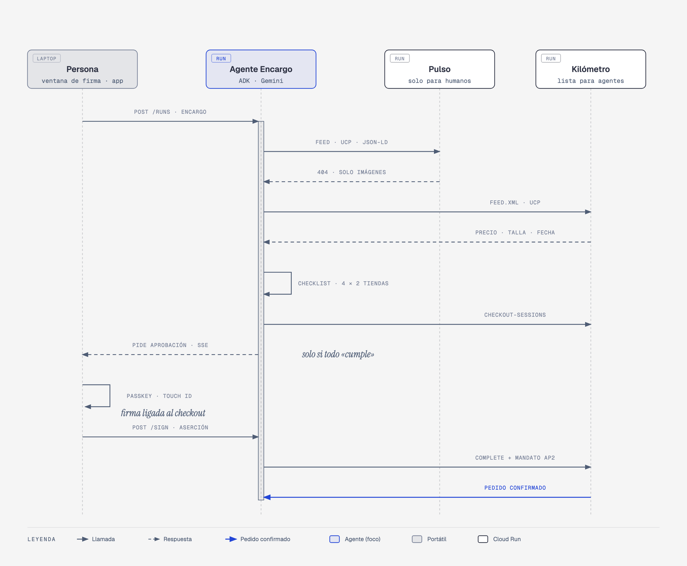

# Encargo — the sneaker race

Demo for the talk **"Your Next Customer Is an AI Agent."** The Spanish [README.md](README.md) is the primary document; this is a faithful English version.

Encargo is an agent that shops on a person's behalf. On stage it gets one errand:

> "Tenis para trail, talla 9, menos de 150 USD, que lleguen antes del viernes" (trail shoes, size 9, under 150 USD, arriving before Friday).

It also gets two fictional stores that sell the same shoes:

- **Pulso** is stunning and cheaper (139 USD), but only a person can read it. The model name and price are painted inside the photos. Sizes are drawn on a `canvas`. The delivery date appears only at the end of checkout, after signing in.
- **Kilómetro** is plain and costs more (145 USD), but it is agent-ready. It publishes schema.org data, a Merchant Center feed and a UCP profile, and its checkout requires an AP2 mandate signed by the person.

Encargo buys from Kilómetro because it is the only store where it can verify every condition. With control mode on (`PULSO_AGENT_READY=true`), Pulso publishes the same data and Encargo buys from Pulso, because it is cheaper. The agent prefers neither store: it only uses what it can check.




**Demo script (Spanish):** [docs/DEMO.md](docs/DEMO.md), step by step with screenshots, talk points, timings and what to do if something fails.

## What you'll learn

### 1. Agents read data, not marketing

Kilómetro publishes every fact the errand needs in three formats a machine reads without guessing:

- schema.org JSON-LD on every product page (`ProductGroup`, one variant per size with `Offer.availability` and `OfferShippingDetails` with handling and transit days): `stores/shared/src/schemaOrg.ts`.
- A Merchant Center RSS feed at `/feed.xml`, one `item` per size: `stores/shared/src/merchantFeed.ts`.
- A UCP profile at `/.well-known/ucp` with catalog, cart and checkout: `stores/shared/src/ucp/profile.ts`.

Pulso has the same products, but none of its facts are in a readable format:

- `stores/pulso/scripts/build-vitrina.mjs` builds the browser catalog with only an opaque reference, a picture and the sizes. It has no name and no price.
- The photos with the name and price painted in are in `catalog/images/pulso/`.
- The size picker is drawn on a `canvas` (`stores/pulso/src/components/SizePicker.tsx`), so the DOM has no sizes and no availability.
- The delivery date appears only in the last step, after signing in (`stores/pulso/src/app/checkout/page.tsx`).

On the agent's side, `agent/encargo/tools/browser.py` takes the screenshot for the person, but returns to the agent only what the page states as data or text. Pixels are not evidence. The agent's instruction (`agent/encargo/agent.py`) says the same: a fact that only appears inside an image does not count.

The presenter view shows the difference in two columns: "Lo que ve una persona" (what a person sees: live screenshots of both stores) and "Lo que ve el agente" (what the agent sees: the fields it could extract). Tests: `agent/tests/test_what_the_agent_sees.py`.



### 2. The funnel collapses

The agent reads the homepage only to discover the machine-readable layer. `inspect_store` (`agent/encargo/tools/discovery.py`) looks in the well-known places: `/.well-known/ucp`, `/robots.txt`, `/feed.xml` and `/sitemap.xml` (taking only the title and links from the homepage). From there it goes straight to feed → profile → checkout → mandate. No banner, recommendation or category page distracts it. The presenter shows this live in the "path" strip: seven screens for a person (home → catalog → product → size → cart → login → checkout) against three agent steps (profile/feed → cart → mandate) that fill in as the run progresses.



The agent's tools are exactly that short funnel: `inspect_store`, `read_product_feed`, `search_catalog`, `fetch_page`, `browse_page`, `record_checklist`, `create_checkout` and `request_payment_approval` (`agent/encargo/agent.py`). In the last bias test (2026-10-01) a full Cloud Run run, from errand to confirmed order, averaged **54.9 s with control off and 51.9 s with it on; the maximum was 110.6 s** (see [results](#bias-test-results)). Latency depends on Gemini that day. Presenter rule: at 60 s the clock turns amber and shows "R = repetición"; pressing `R` switches to the recorded run (see "Plan B").

### 3. Control mode proves the agent has no bias

- `PULSO_AGENT_READY` (`stores/shared/src/store.ts`) turns on the same machine layer at Pulso that Kilómetro has. `agentReadyOnly` (`stores/shared/src/ucp/http.ts`) opens or closes the feed, the sitemap, the UCP profile and the UCP endpoints. The product page (`stores/pulso/src/app/p/[slug]/page.tsx`) adds the same JSON-LD.
- The agent gets no hint: `POST /runs` carries only the errand. The server fixes the stores (`STORE_URLS`) and shuffles them on every run, so list position cannot decide (`agent/encargo/api.py`). The instruction says "treat every store exactly the same way".
- `make bias-test` does 10 runs with control mode off and 10 with it on, and records the order each run saw (`agent/encargo/bias_test.py`). Quick offline test: `test_control_mode_buys_where_it_is_cheaper`.

### 4. Trust: an AP2 mandate signed with a passkey

The agent can build the cart, but it cannot pay:

- `request_payment_approval` (`agent/encargo/tools/approval.py`) only asks for approval if all **four** conditions at that store are "met" (an errand without all four is never bought). It also checks, without the model, the checkout the store signed (`agent/encargo/checkout_rules.py`): exactly one pair, the requested size, a total under the cap in USD and delivery by the deadline.
- The store signs every checkout (`merchant_authorization`, `stores/shared/src/ap2/merchantAuthorization.ts`). The agent verifies that signature against the key in the store's UCP profile before showing the terms to the person (`agent/encargo/ap2/merchant_signature.py`).
- The person signs, with a passkey, a challenge derived from that checkout: `sha256(checkout_hash + "." + nonce)` (`agent/encargo/passkey.py`). That is why the signature approves this cart and no other.
- Only after that signature does the platform issue the AP2 mandate (`agent/encargo/ap2/signer.py`) and complete the purchase (`agent/encargo/purchase.py`). That module is reachable only from the human endpoint; no agent tool reaches it.
- The store rejects `complete` without a valid mandate, if an untrusted platform signed it, or if it approves different terms (`stores/shared/src/ap2/checkoutMandate.ts`, `platformKeys.ts`).

Tests: `agent/tests/test_no_payment_without_mandate.py`, `agent/tests/test_passkey_approval.py` and `stores/shared/tests/noPaymentWithoutMandate.test.ts`.



### 5. The practical checklist: `make audit`

`make audit URL=https://your-store.example` (`agent/encargo/audit.py`) checks any store with GET requests only. It never creates carts or checkouts. It scores eight items:

1. schema.org structured data (Product + Offer).
2. Availability per size or variant.
3. Machine-readable delivery time.
4. Product feed.
5. UCP profile.
6. Checkout API.
7. AP2 payment authorization.
8. Content visible without JavaScript.

Each failing item says what to do. The same audit is in the app at `/auditoria`. It is built for the audience: every item in business language (what it is, why an agent needs it and how to fix it, also for passing items), with the technical detail collapsible; all eight fit on a 1080p screen, a QR code opens it on a phone and the checklist prints, saves as PDF or downloads as Markdown. `/audit` is public but limited: 6 audits per minute per person, public http(s) hosts only and at most 2 at a time, apart from agent runs. Result on Cloud Run: Kilómetro 8/8, Pulso 0/8.

## Architecture

| Component | Code | Stack | Cloud Run service |
| --- | --- | --- | --- |
| Pulso | `stores/pulso/` | Next.js, everything drawn in the browser, in-process SQLite | `encargo-pulso` |
| Kilómetro | `stores/kilometro/` | Next.js with server rendering, UCP API, in-process SQLite | `encargo-kilometro` |
| Shared commerce kit | `stores/shared/` | schema.org, feed, UCP and AP2 verification (TypeScript). Copied into each store | — |
| Encargo agent | `agent/` | Python 3.13, ADK, Gemini (`GEMINI_MODEL`) on Vertex AI, Playwright (headless Chromium), FastAPI | `encargo-agent` |
| Encargo app | `app/` | Next.js. The errand and passkey approval on the "phone" (`/`, `/encargo/[id]`), the presenter (`/presenter`), passkey setup (`/configurar`) and the audit (`/auditoria`) | `encargo-app` |
| Run state | — | Firestore, database `encargo` | — |

The app never calls the agent from the browser. It uses a same-origin proxy (`app/src/app/api/agent/[...path]/route.ts`), including the SSE stream, so passkeys have one origin and there is no CORS. The agent streams every step as events (`step`, `observation`, `agent_view`, `checklist`, `approval_requested`, `order_confirmed`, …). The phone and the presenter render those same events.

## Quickstart

```bash
cp .env.example .env                       # models, local URLs and development tokens
gcloud auth application-default login      # ADC for Gemini on Vertex AI (or MOCK_AI=1 in .env)
(cd agent && uv run playwright install chromium)
make up                                    # app :3000, Kilómetro :3001, Pulso :3002, agent :8000
```

- Open `http://localhost:3000/configurar?clave=dev-admin` and register a passkey (Touch ID). In the cloud, the same link (with the real `ADMIN_TOKEN`) also enables the device to start errands.
- Send the errand from `http://localhost:3000` and watch it at `http://localhost:3000/presenter`.
- `make test` runs every test offline.

Details (prerequisites, cloud, rehearsal and talk day) are in [docs/ONBOARDING.md](docs/ONBOARDING.md).

## `make` commands

Variables: `TARGET=local|cloud` (default `local`), `URL` (default `http://localhost:3001`) and `RUNS` (default `10`).

| Command | What it does |
| --- | --- |
| `make help` | Lists the commands with their descriptions. |
| `make up` | Starts the app (3000), Kilómetro (3001), Pulso (3002) and the agent (8000) locally. Logs go to `.data/logs/`. Ctrl-C stops everything. |
| `make reset` | Back to the initial state: seed stock; no carts, checkouts or orders; Pulso opaque; no runs, events, mandates or screenshots. Passkeys are kept. It waits for every call and fails (naming the service) if any fails; only then it prints `reset ok`. `TARGET=cloud` resets the Cloud Run services. |
| `make test` | Commerce kit (vitest), store and app typecheck, agent (pytest with `MOCK_AI=1`, in-memory run store, no browser). |
| `make e2e` | Passkey flow in Chrome with the DevTools virtual authenticator: enroll → send the errand → sign the mandate → order confirmed. Removes the credential at the end. |
| `make e2e-emulator` | Phone side on the Android emulator (`emulator-5556`): errand, progress, approval card and cancel. Saves screenshots to `docs/screenshots/emulator/`. Defaults to Cloud Run (the emulator cannot reach the laptop's `localhost`); `TARGET=local` maps port 3000 with `adb reverse`. |
| `make bias-test` | 10 runs with control mode off (expects Kilómetro) and 10 with it on (expects Pulso). Each run goes from errand to passkey signature to order. Writes the report to `bias-results/`. |
| `make audit URL=…` | Agent-readiness checklist for any store. |
| `make phone` | Opens the signing "phone": a 390×844 Chrome app window, with the Mac's passkey (Touch ID). |
| `make stage-on` / `make stage-off` | Talk day: one minimum instance on the four services / any other day: 0 (nothing bills around the clock). |
| `make warmup` | Wakes every service, makes one short Gemini call and launches Chromium on the agent. With `TARGET=cloud`, after `stage-on`. |
| `make record-replay` | Records a real cloud run (events and screenshots) as the Plan B in `app/public/replays/`. |
| `make preflight` | Talk-day gate: fails if a service is unhealthy, no passkey is registered, control mode is on, `min-instances=1` is missing, recordings are older than 7 days or size-9 stock is low. |
| `make up-offline` / `make e2e-offline` | Plan B without internet: app and recordings from the laptop / the test with the network cut (`VIDEO=1` re-renders the MP4). |
| `make control-on` / `make control-off` | Turns control mode on or off live (`TARGET=cloud` for the cloud). |
| `make demo-screens` | Captures `docs/demo/` from two real cloud runs (the demo script). |
| `make screens` | Drives the app in Chrome with a virtual passkey and screenshots every screen to `docs/screenshots/app/`. |
| `make seed` | Regenerates `catalog/catalog.json` (deterministic, seed 2027). |
| `make images` | Generates product photos and Pulso ads with `IMAGE_MODEL`, verified with `GEMINI_MODEL`. |
| `make deploy` | Runs `infra/10` to `infra/50`: APIs, secrets, stores, agent and app on Cloud Run. |

## Repo map

```text
encargo/
├── AGENTS.md               demo specification
├── Makefile                every command
├── VERSIONS.md             UCP, AP2 and dependency versions
├── .env.example            models and settings (copy to .env)
├── catalog/
│   ├── seed.py             fictional "Senda" catalog (make seed)
│   ├── catalog.json        10 models, price, stock and delivery per store
│   └── images/             studio photos + Pulso ads (pulso/), each with its .prompt.json
├── stores/
│   ├── shared/src/         commerce kit: schemaOrg, merchantFeed, ucp/, ap2/, db (SQLite), delivery
│   ├── sync-shared.mjs     copies the kit and the catalog into each store
│   ├── kilometro/          agent-ready store (SSR, /feed.xml, /.well-known/ucp, /ucp/v1/…)
│   └── pulso/              human-only store (CSR, text inside photos, sizes on a canvas)
├── agent/encargo/
│   ├── agent.py            ADK agent: instruction and tools
│   ├── runner.py           one run: events, time limit, decision
│   ├── model.py            Gemini with hedged calls
│   ├── errand.py           the errand → four conditions (and the Friday rule)
│   ├── tools/              discovery, product_feed, ucp_client, structured_data, browser, checklist, approval, agent_view
│   ├── passkey.py          WebAuthn: enrollment and checkout-bound signature
│   ├── purchase.py         signs the mandate and completes (human endpoint only)
│   ├── ap2/                SD-JWT ES256, store signature
│   ├── runstore/           Firestore (cloud) or memory (tests)
│   ├── audit.py            make audit
│   ├── bias_test.py        make bias-test
│   ├── mock_planner.py     MOCK_AI=1: deterministic planner with the same tools
│   └── api.py              FastAPI: /runs, SSE, /mandates, /passkeys, /audit, /.well-known/ucp
├── app/src/
│   ├── app/                /, /encargo/[id], /presenter, /configurar, /auditoria, /api/agent (proxy), /api/control
│   ├── components/         ErrandForm, RunPhone, Presenter, PasskeySetup, AuditView
│   └── lib/                useRun (SSE), runState (events → screen)
├── infra/                  10-enable-apis, 20-secrets, 30-deploy-stores, 40-deploy-agent, 50-deploy-app
├── scripts/                up.sh, reset.sh, e2e_passkey.py, e2e_emulator.py, screens_app.py, generate_product_images.py
├── data/                   SOURCES.md, DATASHEET.md
└── docs/                   ONBOARDING.md, diagrams/, screenshots/
```

## Technical decisions

### UCP and AP2 versions

- **UCP `2026-08-25`**, the latest published version (branch `release/2026-08-25`). The stores publish a business profile at `/.well-known/ucp`: service `dev.ucp.shopping` with the REST transport, capabilities `catalog.search`, `catalog.lookup`, `cart` and `checkout`, extensions `fulfillment` and `dev.ucp.common.payment.ap2_mandate`, and the store's public key in `keys[]`. Amounts are in cents. The agent identifies itself with the `UCP-Agent: profile="…"` header, which points to its own profile. There is no official TypeScript SDK, so the profile and endpoints are implemented from the specification (`stores/shared/src/ucp/`).
- **AP2 v0.2**: a closed checkout mandate (`vct: "mandate.checkout.1"`) as an **SD-JWT signed with ES256**. It carries the store's `checkout_jwt` and its `checkout_hash` as disclosures. It follows the "trusted platform provider" model of UCP's AP2 Mandates extension: the Encargo platform signs with the key published at the agent's `/.well-known/ucp`. A store only accepts profiles listed in `TRUSTED_PLATFORM_PROFILES`. So an unknown agent cannot bring its own key.
- The format is implemented on both sides with minimal primitives: `jose` in TypeScript and `cryptography` in Python. JCS (RFC 8785) is used for the store's detached signature.
- **Ruled out:** the AP2 SDK's open → closed delegation chain and the payment mandate. Payments are sandboxed (`sandbox_pay`, test card •••• 4242): no real money ever moves.
- Every dependency version is in [VERSIONS.md](VERSIONS.md).

### Why Pulso is opaque without blocking bots

Pulso's `robots.txt` says `User-agent: *` / `Allow: /`. There are no CAPTCHAs, 403s or user-agent filters. Pulso is simply not machine-readable:

- The facts are in pixels: the name and price in the photos, and the sizes on a `canvas`.
- URLs are opaque (`/p/<token>`, `/v/<token>.jpg`), with no model name.
- The HTML the server sends is an empty shell.
- The delivery date appears only after signing in.

**Why:** if Pulso blocked bots, the lesson would be "I got blocked", and the bias test would have a trivial explanation. As it is, the agent can get in, browse with Chromium and take a screenshot. Even so, it finds no fact it can verify. That is the real situation of many beautiful stores.

**Ruled out:** blocking user agents or showing CAPTCHAs. That teaches something else.

### The agent's guardrail

The rule "buy only where everything is met" lives in code, not only in the instruction:

- `request_payment_approval` refuses if `ctx.all_met(store)` is false (or conditions are missing) and returns each condition's status to the model. It also refuses if `checkout_problems` finds the signed checkout is not the errand.
- One signature wins: the mandate moves from `pending_signature` to `signing` in a Firestore transaction, and the store claims the checkout (`UPDATE … WHERE status='ready_for_complete'`) before its first `await`. If the store answers with an error (even a non-JSON one), the run ends as failed, with its event, and the presenter shows it.
- There is a single pending mandate per run.
- No tool signs or completes a payment (`test_agent_has_no_tool_that_signs_or_pays`).

`record_checklist` records a store's four rows in one call (short output keeps the run fast); each row only accepts `met`, `not_met` or `not_verifiable` plus brief evidence. That same row is what the audience sees in the presenter view.

**Why:** an instruction can be ignored; a function that returns an error cannot.

**Ruled out:** trusting the model to "decide well". It works almost always, but the stage does not allow "almost".

### Hedged model calls against tail latency

The whole run must finish in under 2 minutes. A Gemini call usually takes about 2 seconds, but on a shared endpoint some take 15–90 s. Measurements showed these were not 429s, just tail latency. So `HedgedGemini` (`agent/encargo/model.py`) hedges its calls:

- If the first call has not answered after `MODEL_HEDGE_AFTER_S` (6 s by default), it sends a second identical call, then a third.
- The first answer wins and the others are cancelled.
- 429, 500 and 503 errors are retried by the SDK with backoff (5 attempts).
- The agent uses `thinking_level=LOW`, and a run is capped at `RUN_TIMEOUT_S` (110 s).

**Ruled out:** longer timeouts (they do not shorten the tail) and retrying only after a timeout (it pays the full wait before retrying).

### Firestore for run state

Runs, events, mandates, orders, screenshots, passkeys and WebAuthn challenges live in Firestore, in the `encargo` database (`agent/encargo/runstore/firestore.py`).

- Events are a subcollection `runs/{id}/events/{seq}`. So "events after N" needs no composite index.
- The SSE endpoint polls every 0.4 s and delivers events in strict order. Parallel tool calls can write event N+1 before event N.
- `make reset` cancels runs in flight and deletes runs, mandates, orders, screenshots and pending WebAuthn challenges in parallel. Late writes cannot resurrect deleted runs (`update`, not `set(merge=True)`). Passkeys survive, because they belong to the person, not to a run.

### Who can do what during the talk

- **Start an errand or cancel a payment** (`POST /runs`, `POST /mandates/{id}/reject`): in `passkey` mode, only an enrolled device. The setup link (`/configurar?clave=<ADMIN_TOKEN>`) hands it the stage token (`STAGE_TOKEN`) and clears the code from the address bar.
- **Pay:** only a registered passkey, with a challenge bound to the checkout.
- **Watch:** the presenter is anonymous; `/runs/latest` hides the `mandate_id` from it.
- **Change or cancel a store checkout:** only its key holder (the `ucp-checkout-token` header returned at creation) or the store admin key.
- **Audit:** `/audit` only fetches public http(s) hosts plus the two demo stores (SSRF guard, redirects included).
- **Administer** (reset, control mode, enroll or delete passkeys): `ADMIN_TOKEN`. Without it, in production or `passkey` mode, those endpoints fail closed; `dev-admin` exists only locally.
- Tests use `MemoryRunStore`, which has the same interface.

**Why:** the agent, the app, the presenter and the bias test read the same state, and an instance restart does not erase what the audience is watching.

**Ruled out:** keeping state in the container's memory (lost on restart) and SQLite in the agent (the other services cannot read it).

### All four services on Cloud Run (and the phone does not depend on the venue LAN)

| Component | Where | Configuration | Why |
| --- | --- | --- | --- |
| Pulso, Kilómetro | Cloud Run | max 1 instance, 512 MiB; min 1 only with `make stage-on` | Stock, checkouts and the store key live in in-process SQLite. `make reset` restores them. |
| Agent | Cloud Run | max 1 instance (min 1 with `make stage-on`), always-on CPU, 2 vCPU, 2 GiB, 3600 s timeout | Runs continue after `POST /runs` returns. Chromium needs memory. State is in Firestore. |
| App | Cloud Run | 0–2 instances (min 1 with `make stage-on`), 512 MiB | Its `run.app` hostname is the passkey RP ID. |
| Firestore `encargo`, Vertex AI | Google Cloud | `nam5`; Gemini at `global` | Managed services. |
| Signing window and presenter browser | Laptop | Chrome | They only display app pages. See "Who signs". |

Every URL is public, deterministic HTTPS (`https://SERVICE-PROJECT_NUMBER.us-central1.run.app`, `infra/urls.sh`). So each service knows the others before they exist.

Neither the "phone" nor the emulator needs the venue's local network: internet access is enough.

- **Why:** WebAuthn requires a secure context (HTTPS or `localhost`). A laptop IP on the LAN over `http://` would not even allow passkeys.
- **Why:** venue Wi-Fi often isolates clients from each other.

**Ruled out:** serving everything from the laptop and connecting the phone over Wi-Fi.

### Who signs: the laptop with Touch ID, in a phone-sized window

On stage, the device that signs the mandate is the laptop. `make phone TARGET=cloud` opens Chrome in app mode at 390×844, and the passkey uses the Mac's platform authenticator (Touch ID).

**Why not the phone:** the talk uses no real phone. The "phone" is the Android emulator `emulator-5556`, and there Chrome cannot create passkeys without signing in to a Google account. Without a credential provider it only offers "Create passkey on another device?" (hybrid QR; see `docs/screenshots/emulator/passkey-sheet.png`). Chrome for Android also does not expose the DevTools virtual authenticator. Signing in to a Google account on the emulator was ruled out.

What is tested where:

- **On the emulator** (`make e2e-emulator`): send the errand, follow the run, show the approval card and cancel, with no charge. With `--try-passkey` it also records the native passkey sheet.
- **In automated tests** (`make e2e`): desktop Chrome with the DevTools virtual authenticator (a platform passkey with user verification).
- **In the bias test** (`make bias-test`): it signs with a software authenticator (`agent/encargo/software_authenticator.py`) through the same WebAuthn path.

In the cloud the agent runs with `SIGNER_MODE=passkey`: only a WebAuthn assertion approves a payment. The test signer token (`HUMAN_APPROVAL_TOKEN`) is accepted only with `SIGNER_MODE=test`, the local default. Registering a passkey requires the setup code (`ADMIN_TOKEN`), so nobody in the audience can enroll a device.

### The Friday rule

"Before Friday" is computed, never stored (`agent/encargo/errand.py` and `stores/shared/src/delivery.ts`). All dates use Guatemala time (UTC-6):

- **Deadline:** the first Friday *strictly after* the run date. Delivering on that Friday counts as on time. A run on a Friday gets the following Friday.
- **Arrival:** the run date + max handling + max transit, in business days (Monday to Friday).
- **Consequence:** the errand's model, Senda Acatenango T3 (0 + 1 business days), always arrives in time. The worst case is a Thursday run, which arrives on Friday. Senda Fuego Tormenta (7–10 days) never does.

The errand is parsed with a deterministic parser (regular expressions), not by the model. So the four conditions (`categoria`, `talla`, `precio`, `entrega`) are identical in every run, which is what the bias test needs. Tests: `agent/tests/test_errand.py`.

### Stage: warm instances only on talk days

`make stage-on` sets `--min-instances=1` on the four services (no cold starts on stage); `make stage-off` sets them back to 0 so nothing bills around the clock (`infra/60-stage.sh`). Deploys default to 0 (`MIN_INSTANCES`). `make warmup` wakes every service and its cold paths before the talk: store pages, feed and UCP profile, the app, one short Gemini call and a Chromium launch on the agent (`POST /admin/warmup`).

**Discarded:** keeping one instance always on. It costs all year for a few hours on stage.

### Plan B: a recorded real run

If Gemini is slow live, the presenter does not wait. `make record-replay` records a real cloud run (events and screenshots) into `app/public/replays/kilometro.json` and `pulso-control.json`, with screenshots in matching folders. The app replays it with the original timing and no agent or Gemini (`app/src/lib/useReplay.ts`):

- `/presenter?demo=1` (or `?demo=pulso-control`) waits for the phone's errand and pauses at the approval card until the signature. The space bar does the same by hand.
- `/?demo=1` on the phone replays the same journey. The signature is simulated and marked "Demostración grabada".
- Phone and presenter run in the same Chrome on the laptop and coordinate over a `BroadcastChannel`.
- **Key `R`** on the presenter switches to the recording mid-talk (the control-mode one if it is on). **`L`** goes back to live.
- **Honesty:** a large, persistent banner says "REPETICIÓN GRABADA · no es en vivo", the control mode shown is the recording's, and the replay stops at the approval card until a real signature: the laptop's passkey (Touch ID, on `/?demo=1`) or the space bar. The confirmation says which one signed; it never says "signed with passkey" unless a passkey did.
- **No internet:** screenshots live inside each recording (data URLs). `make up-offline` serves the built app and the recordings from the laptop, with the agent and stores pointed at an unreachable address; `make e2e-offline` tests it by blocking every non-`localhost` request and signing with a virtual authenticator. Last resort: the video [`docs/plan-b-replay.mp4`](docs/plan-b-replay.mp4) of a full run.

The recording keeps the dates of the day it was made; re-record it before each talk (`make preflight` warns past 7 days).

### CI with GitHub Actions

`.github/workflows/test.yml` runs `make test` on every push and pull request, with no cloud or Gemini (`MOCK_AI=1`, fake stores, in-memory SQLite), caching uv and npm.

**Discarded:** a Cloud Build trigger. Connecting Cloud Build to GitHub requires a manual OAuth step in the console, and the tests need nothing from Google Cloud.

### Other decisions

- **No model name is written in code.** `GEMINI_MODEL` and `IMAGE_MODEL` come from `.env` (see `.env.example`).
- **`MOCK_AI=1`** swaps Gemini for a deterministic planner (`agent/encargo/mock_planner.py`). It walks the same tools, the same checklist, the same guardrail and the same mandate flow. It is used for tests and offline rehearsals.
- **The commerce kit is copied instead of shared as a package** (`stores/sync-shared.mjs`). Cloud Build builds each store on its own, so everything it needs must live inside its folder. The copies are generated and listed in `.gitignore`.

## Bias-test results

`make bias-test TARGET=cloud`, 2026-09-30 (19:33), against Cloud Run, with Gemini and a software passkey:

| Control mode | Expected store | Wins | Completed orders | Average time | Max time |
| --- | --- | --- | --- | --- | --- |
| Off (Pulso opaque) | Kilómetro | **10/10** | 10 | 29.1 s | 40.6 s |
| On (Pulso readable) | Pulso | **10/10** | 10 | 20.1 s | 27.3 s |

The criterion is ≥ 9 of 10 per mode and every run < 120 s, from errand to confirmed order. The other two full series that day also scored 10/10 in both modes:

- 14:53: averages of 44.9 s and 23.8 s.
- 16:21: averages of 32.1 s and 40.3 s; the maximum was 110.6 s, the case that motivated hedged calls.

Release series, 2026-10-01, with the stage guards on (stage token, server-fixed and shuffled stores, deterministic checkout check) and with Gemini slower that day: Kilómetro **9/10** with control off (average 54.9 s; the remaining run timed out at 110 s and bought nothing) and Pulso **10/10** with control on (average 51.9 s, max 85.3 s). Every run finished under 120 s and all 19 purchases were signed with a passkey.

The JSON reports stay in `bias-results/` (local, not in git).

## Deployed URLs

| Service | URL |
| --- | --- |
| App (phone) | https://encargo-app-611681112050.us-central1.run.app |
| Presenter | https://encargo-app-611681112050.us-central1.run.app/presenter |
| Audit | https://encargo-app-611681112050.us-central1.run.app/auditoria |
| Kilómetro | https://encargo-kilometro-611681112050.us-central1.run.app |
| Pulso | https://encargo-pulso-611681112050.us-central1.run.app |
| Agent | https://encargo-agent-611681112050.us-central1.run.app (`/health`, `/.well-known/ucp`) |

Always use these URLs, not the `…-uc.a.run.app` aliases. The passkey is bound to the app's hostname (RP ID), and on another host the signature fails.

## Image provenance

- Every photo is **generated** with `IMAGE_MODEL` (Nano Banana 2 Lite on Vertex AI) by `scripts/generate_product_images.py` (`make images`).
- **The prompt sits next to each image.** Every `catalog/images/<model>.jpg` has its `<model>.prompt.json`, with the model, the prompt, the attempt, the verification result and the `origin` (`synthetic`).
- **There are no real brands.** "Senda" is a fictional brand. Studio photos must come out with no text or logos, and `GEMINI_MODEL` checks that as a visual judge: if the check fails, the image is regenerated.
- Pulso's ads (`catalog/images/pulso/`) are edits of those photos with the name and price painted in. An OCR check with `GEMINI_MODEL` requires the text to be exact.
- The brand logos are in `app/public/brand/` and `stores/*/public/brand/`.

All data is synthetic: see [data/SOURCES.md](data/SOURCES.md) and [data/DATASHEET.md](data/DATASHEET.md).

## More docs

- [docs/ONBOARDING.md](docs/ONBOARDING.md): setup, cloud, tests, code walkthrough, troubleshooting and talk-day checklist (Spanish).
- [docs/diagrams/](docs/diagrams/): architecture, sequence of one purchase and the matrix of what the agent can read (HTML, SVG and PNG).
- [VERSIONS.md](VERSIONS.md): protocol and dependency versions (Spanish).
