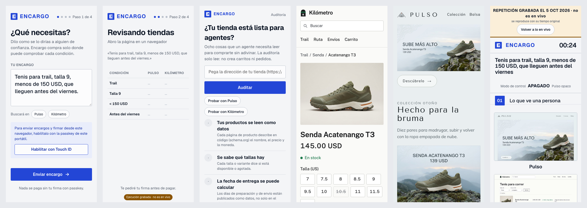

# Encargo — the sneaker race

Demo for the talk **"Your Next Customer Is an AI Agent."** Encargo is an agent that shops for a person: "Tenis para trail, talla 9, menos de 150 USD, que lleguen antes del viernes" (trail shoes, size 9, under 150 USD, arriving before Friday). Two fictional stores sell the same shoes. **Pulso** is cheaper (139 USD), but only a person can read it: its data lives in photos and a `canvas`. **Kilómetro** costs 145 USD, but it is agent-ready (schema.org, feed, UCP and AP2). Encargo buys from Kilómetro because it is the only store where it can verify everything. With control mode on, Pulso publishes the same data and Encargo buys there, because it is cheaper.

The Spanish [README.md](README.md) is the primary document; this is a faithful English version.

## Interactive Codelab (60 min) & Live Demo Lab

- **Published Step-by-Step Codelab:** [https://next-customer-agent-2027.web.app](https://next-customer-agent-2027.web.app)
- **Live Codelab Demo App (`Encargo Auditor & Fixer Lab`):** [https://encargo-auditor-lab-611681112050.us-central1.run.app](https://encargo-auditor-lab-611681112050.us-central1.run.app)
- **Codelab & Demo App Source:** [`codelab/`](codelab/) and [`codelab/demo-app/`](codelab/demo-app/)

## What you'll learn

1. **Agents read data, not marketing:** a fact that only appears inside an image does not count.
2. **The funnel collapses:** seven screens for a person, three steps for the agent.
3. **Control mode proves the agent has no bias:** given the same data, it buys where it is cheaper.
4. **Trust:** the agent builds the cart, but only a passkey signs the AP2 mandate that pays.
5. **The practical checklist:** `make audit` scores any store on eight points.


## On talk day

Nothing is run. Two pages are opened in the same Chrome on the laptop:

- **Presentador** (projector view, only for the live demo), on the projector: https://encargo-app-611681112050.us-central1.run.app/presentador. When it opens it wakes the stores, the agent and Gemini, and if it sat idle for a while it starts from scratch. It says «Preparando la demo…» and, in about 15–20 s, «Envía un encargo desde la app». The control-mode switch, «Empezar de nuevo» and «Ver la ejecución grabada» (Plan B) are there.
- **Phone**, on the laptop screen: https://encargo-app-611681112050.us-central1.run.app. The errand is sent and signed with Touch ID there.

The full script is in [docs/DEMO.en.md](docs/DEMO.en.md).

## Quickstart (development)

```bash
cp .env.example .env                       # models, local URLs and development tokens
gcloud auth application-default login      # ADC for Gemini on Vertex AI (or MOCK_AI=1 in .env)
(cd agent && uv run playwright install chromium)
make up                                    # app :3000, Kilómetro :3001, Pulso :3002, agent :8000
open "http://localhost:3000/configurar?clave=dev-admin"   # register a passkey (Touch ID)
open http://localhost:3000/presentador     # send the errand from http://localhost:3000
make test                                  # every test, offline
```

**Bias test** (`make bias-test TARGET=cloud`, 2026-10-01): Kilómetro 9/10 with control off and Pulso 10/10 with control on, every run under 120 s ([details](docs/DECISIONES.en.md#bias-test-results)).

## Deployed pages

**The product, what anyone can try** (on a phone, tablet or computer):

| Page | URL | What it is |
| --- | --- | --- |
| Encargo app | https://encargo-app-611681112050.us-central1.run.app | Write the errand, watch the agent decide and sign the purchase with your passkey |
| Audit | https://encargo-app-611681112050.us-central1.run.app/auditoria | Paste a store's address and see how ready it is for agents |
| Kilómetro | https://encargo-kilometro-611681112050.us-central1.run.app | Fictitious agent-ready store |
| Pulso | https://encargo-pulso-611681112050.us-central1.run.app | Fictitious store that is opaque to agents |

They all adapt to phones and tablets. On a 375 px phone: the app, an errand in progress, the audit, Kilómetro, Pulso and the presentador.



**Only for the live demo:**

| Page | URL | What it is |
| --- | --- | --- |
| Presentador | https://encargo-app-611681112050.us-central1.run.app/presentador | The projector view: shows large what a person sees, the agent's reasoning and what the agent sees. It prepares the services when it opens and holds the talk's buttons. Not part of the product |

The agent has no page: it is a service (https://encargo-agent-611681112050.us-central1.run.app, with `/health` and `/.well-known/ucp`). The old `/presenter` address leads to the presentador.

## Documentation

- [docs/DEMO.en.md](docs/DEMO.en.md): demo script with screenshots, talk points, timings and what to do if something fails ([Spanish](docs/DEMO.md)).
- [docs/ONBOARDING.md](docs/ONBOARDING.md): setup, cloud, tests, code walkthrough, troubleshooting and talk-day checklist (Spanish).
- [docs/DECISIONES.en.md](docs/DECISIONES.en.md): what the demo teaches in detail, every technical decision, UCP and AP2 versions, and bias-test results.
- [docs/COMANDOS.en.md](docs/COMANDOS.en.md): every `make` command.
- [docs/ESTRUCTURA.en.md](docs/ESTRUCTURA.en.md): components, services and repo map.
- [docs/CREDITOS.en.md](docs/CREDITOS.en.md): image and data provenance.
- [VERSIONS.md](VERSIONS.md): protocol and dependency versions (Spanish).
- [docs/diagrams/](docs/diagrams/): architecture, what the demo tests, sequence of one purchase, readability matrix and funnel (HTML, SVG and PNG).
- [data/SOURCES.md](data/SOURCES.md) and [data/DATASHEET.md](data/DATASHEET.md): synthetic data.

## Use your own Google Cloud project

The `infra/` scripts read `PROJECT_ID` (the talk's project by default). To deploy to yours, run
`PROJECT_ID=<your-project> make deploy` and put the same ID in `.env`. Details in the
[onboarding guide](docs/ONBOARDING.md) (Spanish).

## License

Code under [Apache 2.0](LICENSE). Catalog images are synthetic; the brand, stores and data are fictional
([NOTICE](NOTICE), [credits](docs/CREDITOS.en.md)).
