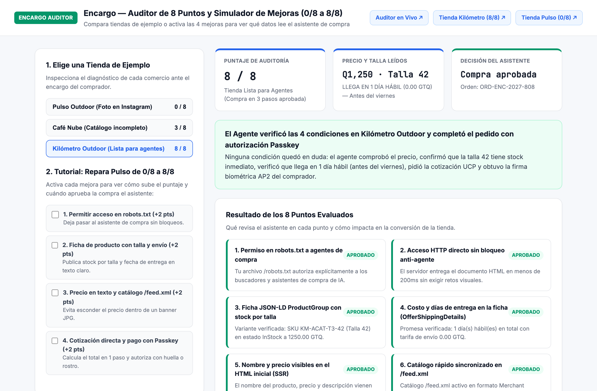
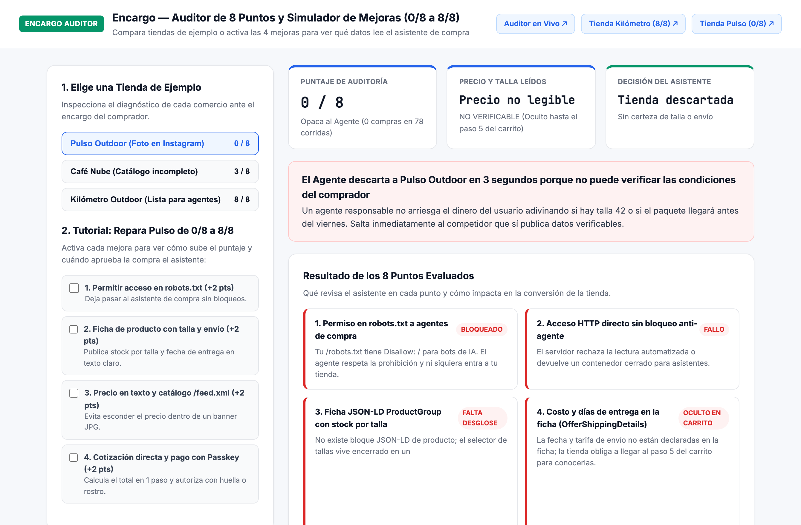
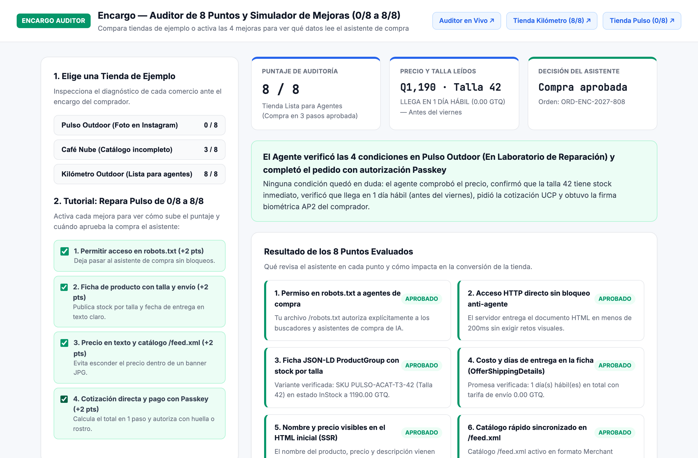
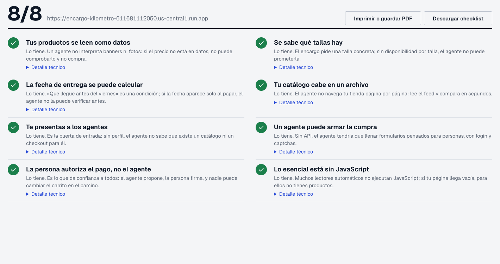

## 1. Qué vas a lograr y cómo se ve al final | 8

No necesitas instalar nada en tu computadora para realizar este taller. Trabajarás directamente en tu navegador usando las herramientas públicas desplegadas en internet para **auditar tiendas en línea con ejemplos comentados** y practicar **cómo llevar una tienda de `0/8` a `8/8` puntos** para que un asistente de IA pueda encontrar tus productos, verificar tallas y fechas de entrega, y completar un pedido.

:::info
**Enlaces públicos que usarás durante el taller**
1. **Simulador Interactivo de Auditoría y Reparación (`0/8 a 8/8`):** [`https://encargo-auditor-lab-611681112050.us-central1.run.app`](https://encargo-auditor-lab-611681112050.us-central1.run.app)
2. **Auditor en vivo para cualquier URL:** [`https://encargo-app-611681112050.us-central1.run.app/auditoria`](https://encargo-app-611681112050.us-central1.run.app/auditoria)
3. **Tienda Pulso (`0/8` — pensada solo para ojos humanos):** [`https://encargo-pulso-611681112050.us-central1.run.app`](https://encargo-pulso-611681112050.us-central1.run.app)
4. **Tienda Kilómetro (`8/8` — lista para personas y agentes):** [`https://encargo-kilometro-611681112050.us-central1.run.app`](https://encargo-kilometro-611681112050.us-central1.run.app)
5. **App Encargo (asistente de compras):** [`https://encargo-app-611681112050.us-central1.run.app`](https://encargo-app-611681112050.us-central1.run.app)
:::

### Así se ve la herramienta cuando tu tienda alcanza `8/8`

Al abrir el [Simulador de Auditoría y Reparación](https://encargo-auditor-lab-611681112050.us-central1.run.app), verás una vista limpia de dos columnas: a la izquierda seleccionas una tienda de ejemplo o activas las 4 mejoras; a la derecha ves el puntaje (`8/8`), los datos exactos que logra leer el asistente (`Q1,250 · Talla 42 · Entrega en 1 día hábil`) y el estado de los 8 puntos evaluados:



---

## 2. Por qué una tienda atractiva en Instagram puede perder la venta ante un asistente | 8

Imagina que un martes por la noche una persona busca unas botas impermeables para subir el volcán Acatenango el fin de semana. En lugar de abrir varias pestañas y llenar formularios en el teléfono, le escribe este encargo a su asistente de IA en [`https://encargo-app-611681112050.us-central1.run.app`](https://encargo-app-611681112050.us-central1.run.app):

:::tip
**El encargo del comprador**
«Consígueme unas botas impermeables Acatenango T3 en talla 42 (US 9), por menos de Q1,290 ($150 USD), y asegúrate de que lleguen antes del viernes».
:::

Abre en tu navegador las dos tiendas públicas que venden el mismo calzado y compáralas:

- **[Pulso Outdoor (`https://encargo-pulso-611681112050.us-central1.run.app`)](https://encargo-pulso-611681112050.us-central1.run.app):** Tiene un diseño visual llamativo y mejor precio (`Q1,190` / `$139 USD`), pero el precio de oferta está dibujado dentro de una imagen JPG, el selector de tallas está encerrado en un gráfico `<canvas>` y la fecha de envío solo aparece después de llenar 5 pantallas del carrito.
- **[Kilómetro (`https://encargo-kilometro-611681112050.us-central1.run.app`)](https://encargo-kilometro-611681112050.us-central1.run.app):** Cuesta `Q1,250` (`$145 USD`), pero publica precio, disponibilidad por talla y días de entrega en texto estructurado desde la primera página.

:::warn
**Un asistente de compras no adivina con el dinero del cliente**
Cuando el asistente no puede comprobar si la talla 42 está disponible o si el paquete llegará antes del viernes, descarta la tienda en segundos y elige el comercio donde sí puede verificar las 4 condiciones del comprador.
:::

---

## 3. Qué significan los 8 puntos de la auditoría | 10

Cuando evalúas una tienda en [`https://encargo-app-611681112050.us-central1.run.app/auditoria`](https://encargo-app-611681112050.us-central1.run.app/auditoria) o en el [Simulador Interactivo](https://encargo-auditor-lab-611681112050.us-central1.run.app), el diagnóstico revisa **8 puntos prácticos** divididos en el recorrido de compra:

| Punto evaluado | Qué busca el asistente | Qué ocurre si falta en tu tienda |
| :--- | :--- | :--- |
| **1. Permiso en `robots.txt`** | Que tu archivo `/robots.txt` permita la entrada a buscadores de compra (`OAI-SearchBot`, `Claude-SearchBot`). | El asistente respeta la prohibición y ni siquiera entra a ver tus productos. |
| **2. Página accesible sin trabas visuales** | Que el servidor entregue la página del producto sin obligar a resolver acertijos de imágenes antes de ver el catálogo. | El asistente no puede leer el producto y salta al siguiente comercio. |
| **3. Disponibilidad por talla o variante** | Que cada talla (`Talla 41`, `Talla 42`) indique claramente si está en stock o agotada. | Si solo dice «En stock general», el asistente no se arriesga a comprar una talla agotada. |
| **4. Costo y días de envío visibles** | Que la tarifa de envío y los días de entrega estén declarados en la ficha del producto. | Si el comprador pidió «que llegue antes del viernes», tu tienda queda descartada por falta de fecha. |
| **5. Nombre y precio en texto HTML** | Que el nombre y el precio vengan en texto desde el servidor y no escondidos dentro de un banner JPG. | Los lectores rápidos de los asistentes no ven el precio de oferta. |
| **6. Catálogo rápido (`/feed.xml`)** | Un archivo con tus productos, precios y existencias al día (el mismo que usas para Google Shopping o Meta Ads). | El asistente tarda mucho más en revisar qué modelos tienes disponibles. |
| **7. Cotización en un solo paso** | Poder consultar el total exacto (producto + envío + impuestos) sin recorrer 7 pantallas manuales de checkout. | El proceso se rompe si algún formulario visual intermedio cambia. |
| **8. Autorización con huella o rostro (`Passkey`)** | Permitir que el comprador apruebe el monto exacto desde su teléfono con Touch ID o Face ID. | El cliente no tiene que escribir ni compartir los 16 dígitos de su tarjeta con el chat de IA. |

---

## 4. Probar la auditoría con los 3 ejemplos comentados | 12

Abre [`https://encargo-auditor-lab-611681112050.us-central1.run.app`](https://encargo-auditor-lab-611681112050.us-central1.run.app) y haz clic en los 3 botones de la sección **«1. Elige una Tienda de Ejemplo»** en la columna izquierda:

### Caso A: `Pulso Outdoor` (`0 / 8 puntos`)
Al seleccionar **Pulso Outdoor**, verás cómo todos los puntos aparecen en rojo con su nota explicativa. Aunque Pulso tiene el precio más bajo (`Q1,190`), el asistente reporta `Precio no legible` y `Tienda descartada`:



### Caso B: `Café Nube` (`3 / 8 puntos`)
Haz clic en **Café Nube (Catálogo incompleto)**. Esta tienda sí deja pasar al asistente y muestra el precio en texto (`3/8`), pero no desglosa el stock por talla ni indica cuántos días tarda el envío. El resultado es el mismo: el asistente no puede garantizar que llegue el viernes y descarta la compra.

### Caso C: `Kilómetro Outdoor` (`8 / 8 puntos`)
Haz clic en **Kilómetro Outdoor**. Los 8 puntos están aprobados en verde y el asistente confirma el pedido `ORD-ENC-2027-808`.

---

## 5. Tutorial práctico: Repara la tienda de `0/8` a `8/8` | 14

En la parte inferior izquierda del [Simulador Interactivo](https://encargo-auditor-lab-611681112050.us-central1.run.app) encontrarás la sección **«2. Tutorial: Repara Pulso de 0/8 a 8/8»**. Ve activando las 4 casillas una por una y observa qué cambia en tu tienda:

### Mejora 1: Permitir el acceso a buscadores de compra en `robots.txt` (Sube a `2/8`)
Muchos comercios bloquearon todos los bots en años anteriores para evitar entrenamiento de modelos y, sin querer, cerraron también la puerta a los asistentes que traen compradores. Puedes separar ambos permisos en tu archivo `/robots.txt`:

```text
# Permitir asistentes de búsqueda y compra que traen clientes
User-agent: OAI-SearchBot
Allow: /

User-agent: Claude-SearchBot
Allow: /

# Si deseas bloquear recolección masiva para entrenamiento, hazlo por separado:
User-agent: CCBot
Disallow: /
```

### Mejora 2: Agregar la ficha de producto con stock por talla y días de envío (Sube a `4/8`)
Pega en el HTML de tu página de producto un bloque `<script type="application/ld+json">` estándar de `Schema.org`. Esto le dice a Google, a los buscadores y a los agentes de IA el precio exacto, qué tallas tienen stock y cuánto tarda el envío:

```html
<script type="application/ld+json">
{
  "@context": "https://schema.org",
  "@type": "ProductGroup",
  "name": "Botas Acatenango T3 Impermeables",
  "hasVariant": [
    {
      "@type": "Product",
      "sku": "PULSO-ACAT-T3-42",
      "size": "42",
      "offers": {
        "@type": "Offer",
        "price": "1190.00",
        "priceCurrency": "GTQ",
        "availability": "https://schema.org/InStock",
        "shippingDetails": {
          "@type": "OfferShippingDetails",
          "shippingRate": { "@type": "MonetaryAmount", "value": "0.00", "currency": "GTQ" },
          "deliveryTime": {
            "@type": "ShippingDeliveryTime",
            "handlingTime": { "@type": "QuantitativeValue", "minValue": 0, "maxValue": 0, "unitCode": "DAY" },
            "transitTime": { "@type": "QuantitativeValue", "minValue": 1, "maxValue": 1, "unitCode": "DAY" }
          }
        }
      }
    }
  ]
}
</script>
```

### Mejora 3 y Mejora 4: Precio en texto HTML, catálogo `/feed.xml` y pago con Passkey (Llega a `8/8`)
Marca las casillas **3** y **4** en el simulador. Verás cómo Pulso Outdoor sube a **`8 / 8`** y, al tener mejor precio que Kilómetro (`Q1,190` frente a `Q1,250`) ofreciendo ahora la misma certeza en talla y envío, el asistente elige a Pulso y aprueba la compra:



---

## 6. Audita tu propio comercio y arma tu plan de acción | 8

Para cerrar el taller, abre el auditor público en [`https://encargo-app-611681112050.us-central1.run.app/auditoria`](https://encargo-app-611681112050.us-central1.run.app/auditoria) y pega la dirección de cualquier tienda en línea que administres o uses con frecuencia:



### Orden recomendado para aplicar estas mejoras en tu tienda

1. **Hoy mismo (15 minutos):** Revisa `tudominio.com/robots.txt` y verifica que no estés bloqueando a los buscadores de asistentes de IA ni ocultando precios dentro de imágenes.
2. **Esta semana (1 a 2 horas):** Activa o completa los datos de **disponibilidad por talla/variante** y **tiempos de entrega** en la ficha `Schema.org` de tus páginas de producto (en Shopify, WooCommerce o VTEX puedes hacerlo desde la plantilla del tema) y verifica que tu `/feed.xml` esté actualizado.
3. **Siguiente trimestre:** Incorpora endpoints de cotización directa y métodos de pago con confirmación biométrica (`Passkeys` / billeteras digitales) para reducir el abandono en el checkout.
