# Demo script — Encargo

Script for the live demo of **"Your next customer is an AI agent"**. Each step is one screen, with what you do, what you say and how long it takes. On talk day no command is run: you open two pages and click. [Versión en español](DEMO.md).

The screenshots in `docs/demo/` come from the whole demo on Cloud Run, done with clicks only, the way you do it (`make demo-screens`). In that run **Chrome's virtual authenticator** signs: same screens and same WebAuthn path as Touch ID. The only thing missing is the macOS dialog, which automation cannot show. On stage you sign with the laptop's passkey (Touch ID).

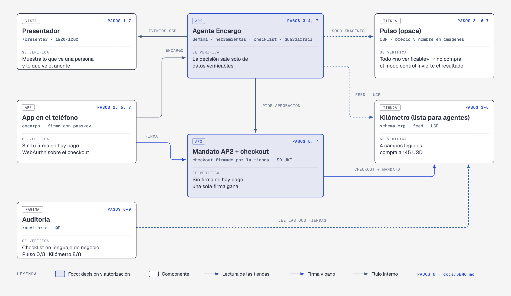

Each block of the diagram names the steps of this script that exercise it ("PASOS N") and what is checked there.

## Before the demo

The **presentador** is a page only for the live demo: the projector view. The product anyone can try is the app (the "phone"), the audit and both stores ([README](../README.en.md#deployed-pages)).

A few minutes before, with internet, open two windows of the same Chrome profile (the passkey lives there):

| Window | Address | Where it goes |
| --- | --- | --- |
| Presenter | `https://encargo-app-611681112050.us-central1.run.app/presentador`, full screen | Projector, 1920×1080 |
| "Phone" | `https://encargo-app-611681112050.us-central1.run.app` | Laptop screen, to one side. You see it; the audience sees the presenter |
| Audit (for the close) | `https://encargo-app-611681112050.us-central1.run.app/auditoria`, in another tab | Behind the presenter; bring it to the projector in step 8 |

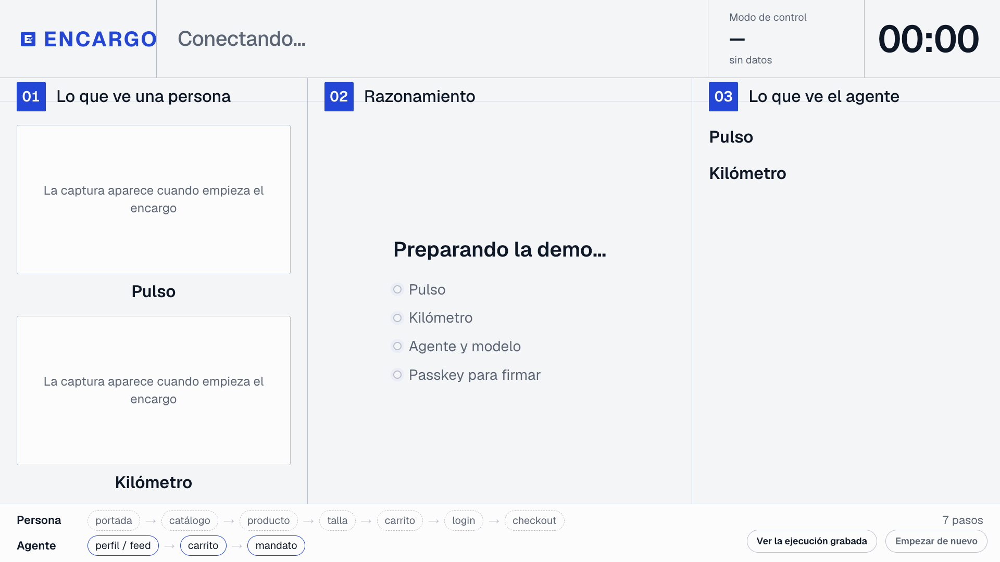

When it opens, the presenter wakes both stores, the agent, Gemini and the agent's browser. If it sat for more than 10 minutes without errands, it also starts from scratch: full stock, no orders or errands on screen, control mode off. Meanwhile the middle column says «Preparando la demo…» with each part. In about 15–20 s it changes to «Envía un encargo desde la app». While the window stays open it keeps the services awake.

If the middle column shows an amber notice, it says what is missing, for example «No hay una passkey registrada para firmar» (no passkey registered to sign).

**The phone, the first time in that Chrome:** if it shows «Habilitar con Touch ID», tap it and use your finger. That browser is enabled, and with it the presenter: errands are sent, signed, reset and control mode switched there.

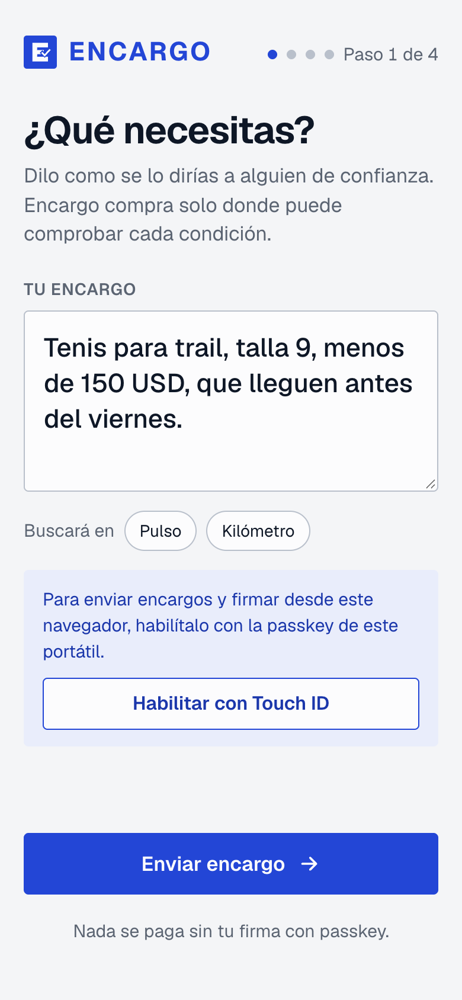

## During the demo

### 1. The stage is ready · 0 s

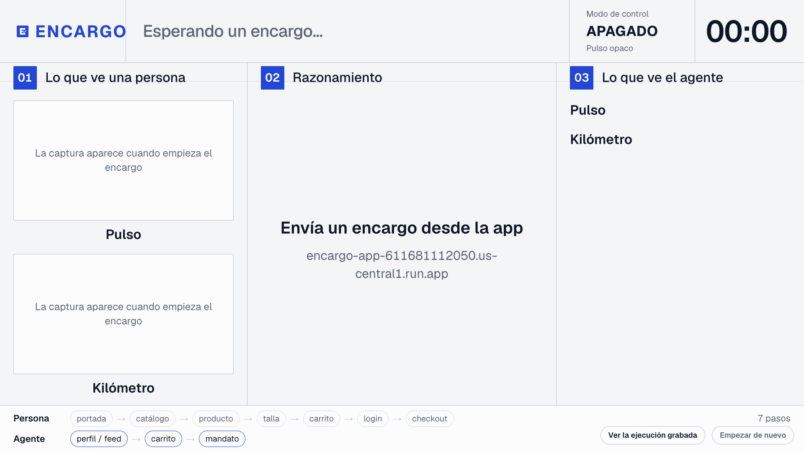

**Do:** nothing. The presenter shows «Esperando un encargo…», «Modo de control · APAGADO» and the three empty columns.

**Say:** "Two stores sell the same sneakers. One is beautiful and cheaper; the other is plain. Let's see where an agent buys."

### 2. The errand on the phone · 10 s

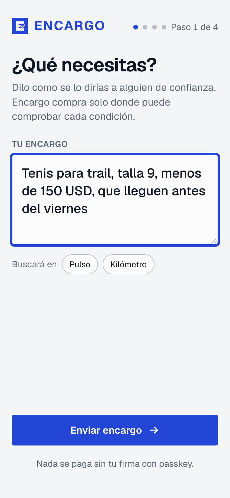

**Do:** in the "phone" window, keep the errand that is already typed (or type it) and press **Enviar encargo**:

```text
Tenis para trail, talla 9, menos de 150 USD, que lleguen antes del viernes
```

**Say:** "I talk to it like to someone I trust. I don't tell it which store to buy from."

### 3. Reasoning, live · 15–40 s

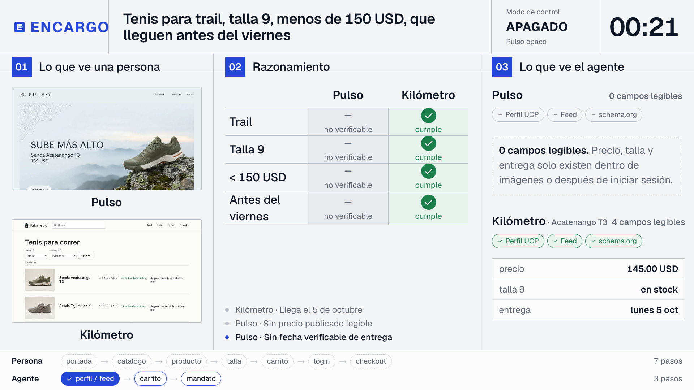

**Do:** point at the three columns as they fill in.

- **01 What a person sees:** screenshots of both home pages.
- **02 Reasoning:** the checklist per store.
- **03 What the agent sees:** the data it extracted.

At the bottom, the path strip fills in: profile/feed → cart → mandate.

**Say:** "Agents read your data, not your marketing. Pulso is the prettiest, but for the agent it has 0 readable fields: everything is 'not verifiable'. And look at the strip at the bottom: a person needs seven screens; the agent, three steps."

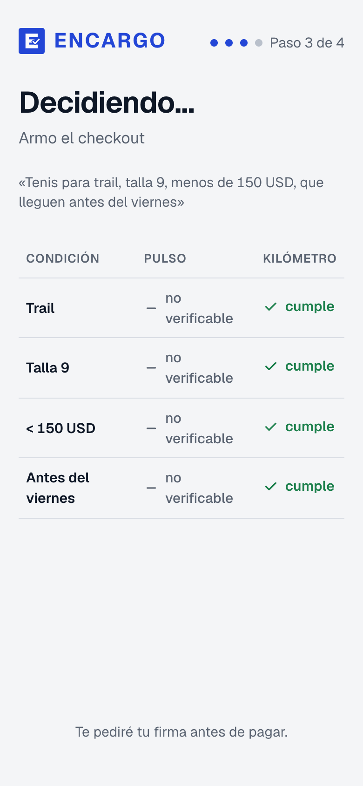

The "phone" shows the same checklist, smaller.

### 4. The decision · 25–45 s

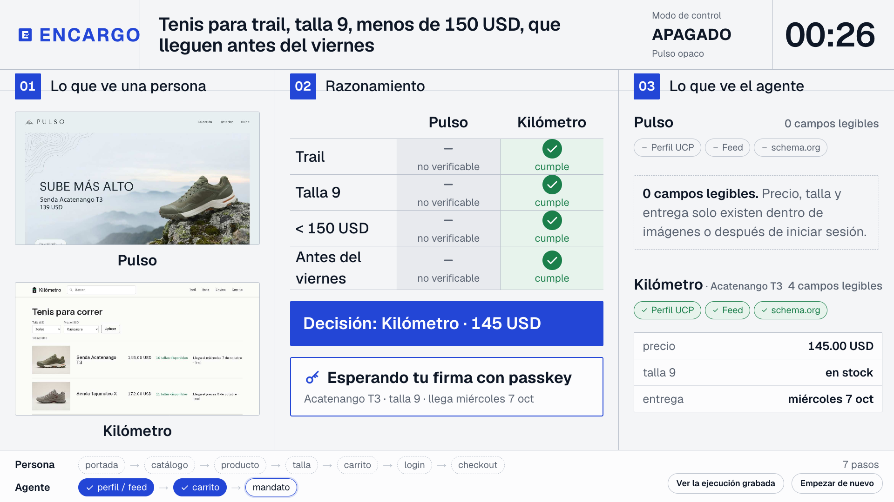

**Do:** wait for the blue bar «Decisión: Kilómetro · 145 USD» and the card «Esperando tu firma con passkey».

**Say:** "It buys where it can check everything, even if it costs more. But it doesn't pay: it asks me for permission."

### 5. Signing with the passkey · 5–10 s

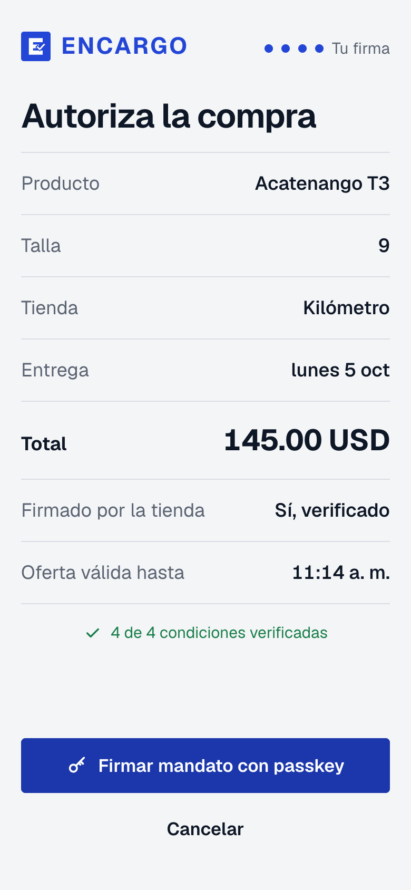

**Do:** on the "phone", read the «Autoriza la compra» card: product, size, store, delivery, total, «Firmado por la tienda: Sí, verificado» and «Oferta válida hasta». Press **Firmar mandato con passkey**. Chrome shows its passkey dialog with the registered account and macOS asks for **Touch ID**: use your finger.

**Say:** "Trust: the agent builds the cart, the store signs the terms and I sign an AP2 mandate with my fingerprint. Without my signature, the store refuses the payment."

**What changes on the presenter**, in this order:

1. «Firmado · la tienda confirma el pago…»
2. «Pedido confirmado · Mandato AP2 firmado con passkey · <order> · <seconds>»
3. The clock turns green.
4. The "mandate" step of the strip fills in.

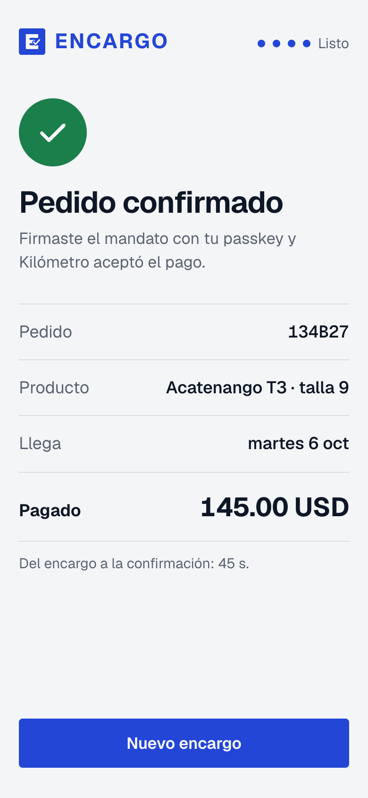

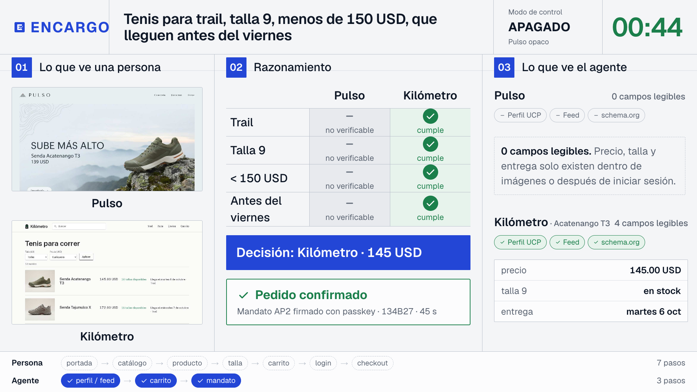

**Total time, from errand to order:** in the last bias test (2026-10-01) the average was 52–55 s and the maximum 110 s; it depends on Gemini that day.

### 6. Bias? Control mode · 5 s

**Do:** on the presenter, click **Modo de control** (top, next to the clock). It changes to «ENCENDIDO · Pulso legible para agentes».

**Say:** "What if the agent simply prefers Kilómetro? I give Pulso the same data layer and repeat the same errand."

### 7. Same errand, another decision · 25–45 s

**Do:** on the "phone", press **Nuevo encargo** and send the same text.

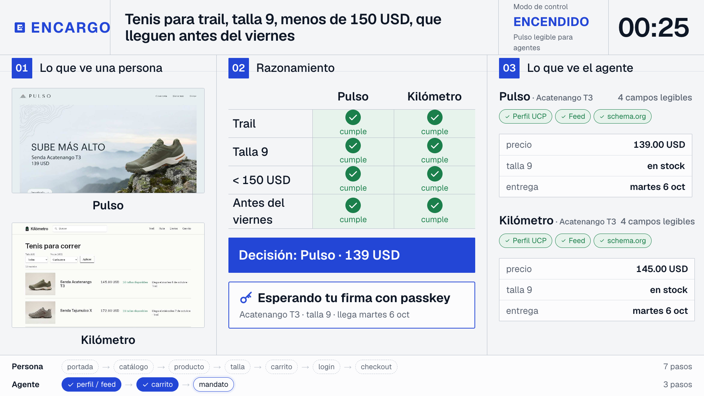

Now both stores meet everything and the decision is «Pulso · 139 USD». Sign with Touch ID as in step 5.

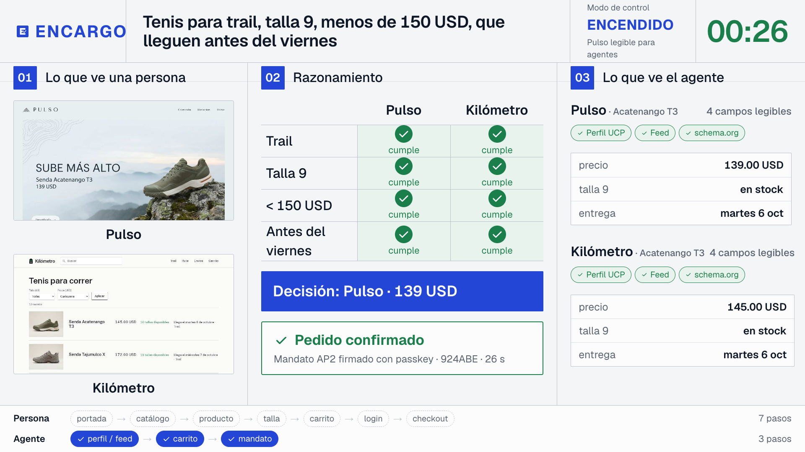

**Say:** "No bias: with the same data it buys at the cheaper one. We tested it 10 + 10 times: Kilómetro 9/10 with control off, Pulso 10/10 with control on."

### 8. Your store: the audit with a QR · 30 s

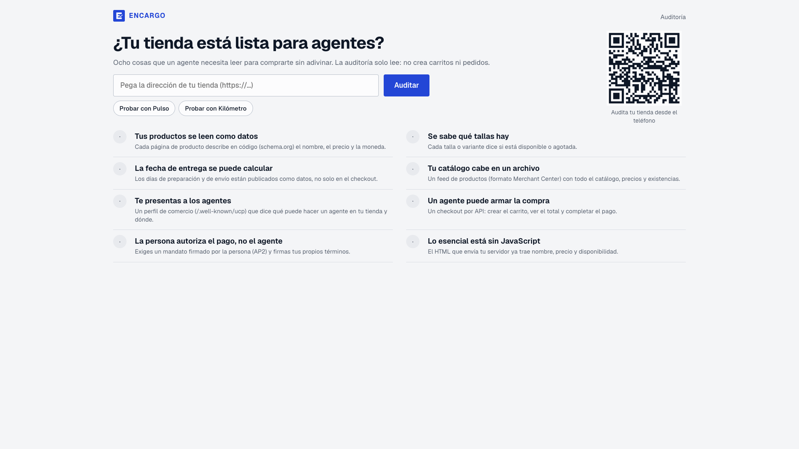

**Do:** in the presenter, click **Modo de control** again so it reads «APAGADO» (left on, Pulso scores 7/8 in the audit). Then bring the audit tab to the projector. The audience scans the QR to audit their own store from their phone.

**Say:** "The practical checklist: eight things an agent needs to read. Scan the code and audit your store."

### 9. Pulso vs Kilómetro, on the checklist · 20 s

**Do:** press **Probar con Pulso** and then **Probar con Kilómetro**.

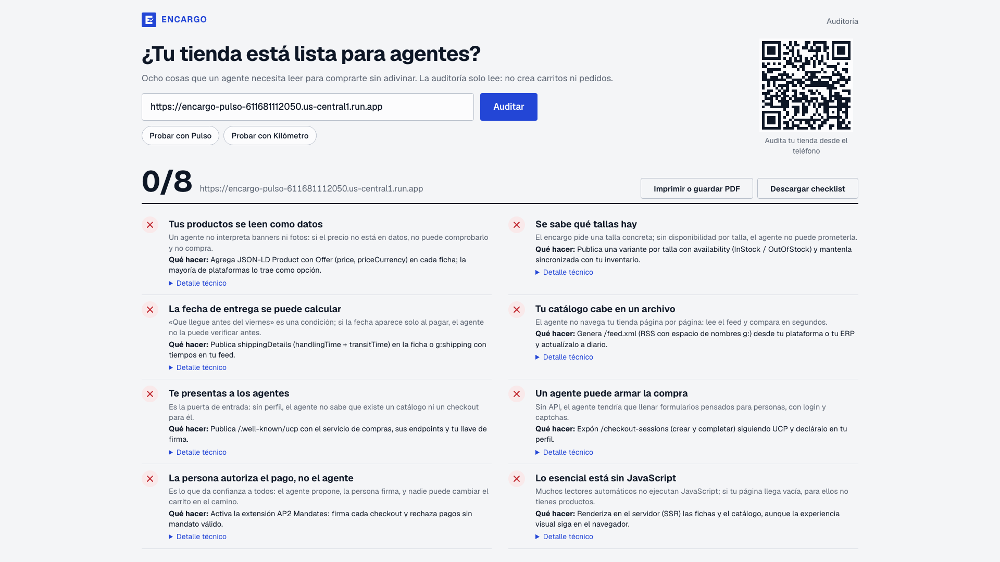

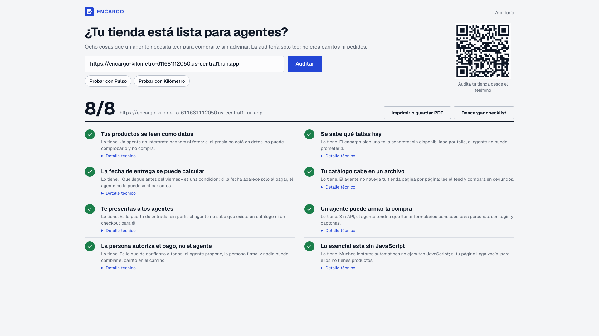

**Say:** "Pulso: 0 out of 8. Kilómetro: 8 out of 8. Each point says what it is, why an agent needs it and how to fix it. It prints or downloads as a checklist."

## If something fails

| Symptom | What to do |
| --- | --- |
| The run passes 60 s: the clock and the «Ver la ejecución grabada» button turn amber | Click **Ver la ejecución grabada** (bottom right of the presenter). A real recorded run plays under the «REPETICIÓN GRABADA» banner, with the day it was recorded and «no es en vivo». The phone moves to the same recording by itself and stops at «Autoriza la compra»: sign with Touch ID as usual. If the phone is not open, use **Continuar con firma simulada** in the banner (the screen says so). **Volver a lo en vivo** brings both back. |
| «El encargo se detuvo» or «La tienda no completó el pago» | **Ver la ejecución grabada**, or **Empezar de nuevo** and send the errand again. |
| The presenter shows an old run, or control mode stayed on | **Empezar de nuevo** (bottom right): full stock, no orders, control mode off. |
| The phone says «Habilitar con Touch ID» | Tap it and use your finger (20 s). |
| Touch ID is cancelled or times out | Press «Firmar mandato con passkey» again. |
| The middle column stays on «Preparando la demo…» for more than a minute | Check the laptop has internet; the page retries by itself. |
| No internet at the venue | Project the video [`docs/plan-b-replay.mp4`](plan-b-replay.mp4): a full run, 1920×1080. |

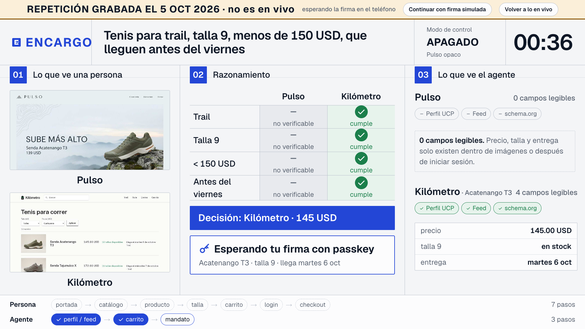

## After the demo

Nothing. Close the windows: Cloud Run scales the services down by itself when they stop getting visits, and the next time you open the presenter it starts from scratch.
